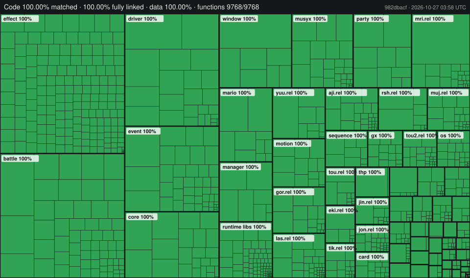

Paper Mario: The Thousand-Year Door
![Progress] ![Functions Progress] ![Data Progress] ![Linked Progress]
=============

[Progress]: https://img.shields.io/badge/Code-100.00%25-blue
[Functions Progress]: https://img.shields.io/badge/Functions-100.00%25-blue
[Data Progress]: https://img.shields.io/badge/Data-100.00%25-blue
[Linked Progress]: https://img.shields.io/badge/Linked-100.00%25-blue

A matching decompilation of Paper Mario: The Thousand-Year Door. Seven versions are complete: the Japanese (G8MJ01), US (G8ME01) and European (G8MP01) releases, the early Japanese and US demos (G8MJ01_DEMO, G8ME01_DEMO) and the September 2004 US and European demos (G8ME01_DEMO2, G8MP01_DEMO). Every unit is built from C and each build reproduces its original game byte for byte.

## Origins and credit

This repository continues [LLCOOLT/ttyd](https://github.com/LLCOOLT/ttyd), the first tree to match both releases completely, with the author's permission. That tree started as a fork of [doldecomp/ttyd](https://github.com/doldecomp/ttyd), which grew out of [NWPlayer123](https://github.com/NWPlayer123)'s original G8MJ01 decomp-toolkit setup; the project structure, build system, splits, symbols and the early decompilation work come from them and their contributors, and the US version builds on this repository's earlier US decompilation. Many thanks to everyone who worked on it. The original MIT licence and copyright notice are kept in [LICENSE](LICENSE). The doc comments above most functions and event scripts come from LLCOOLT's later readability pass (used with the author's permission); comments starting with `Guess:` or `Unknown:` are inferred. Struct field names in the battle, pouch and item headers follow jdaster64's ttyd-utils notes, and the icon names follow Zephiles' IconType list from his Practice Codes (both used with permission; [docs/NAME_PROVENANCE.md](docs/NAME_PROVENANCE.md) has the details).

It is an **independent project and is not affiliated with doldecomp**. The code added since the fork was written with the help of AI tools (Anthropic's Claude). Please don't take questions about this repository to the doldecomp community; use this repository's issues instead.

## Cleanup

With every version matching, the work here is cleanup: the C should read like plausible original source, with no matching tricks left, while all builds stay byte-identical to the original games. The European release and the demos came from LLCOOLT's tree (with the author's permission), adapted to this tree's names. Every change is checked against all seven versions (hashes) and objdiff (100 % code and data). Highlights so far:

- **MSL math headers as precompiled headers.** Every unit of the original carries constants from MSL's paired-single sine/cosine helpers and the sqrtf inline, which the compiler emits when the math headers are precompiled. The units now load `include/msl_rel.pch` / `include/msl_main.pch` (`libs/msl/include/math.h`, `libs/msl/include/dtrigf.h`, our own reconstruction) instead of carrying about 17,000 lines of hand-made copies; the RELs are linked without stripping, as the originals were, so none of the 600 REL `force_active` pragmas is needed.
- **No dead-strip guards**: functions the linker strips are ordinary C again (the JP demo's linker maps list them as unused).
- **Real sizes and alignment instead of padding**: tables, strings and GX arrays take their sizes from the US symbol map and their 32-byte alignment from the declaration; most `gap_*` filler objects, section placements and `force_active` pragmas are gone.
- **Prototypes and types**: calls through casts to another prototype replaced by the right declarations, calls without prototypes fixed, string pools written as literals.
- **File-local functions and data are `static`** where the JP demo's original linker maps list them as local (about 1,300).
- **Comments checked against the code**: every source file and every room and battle-unit script was read, thousands of wrong comment claims were fixed, and retail bugs found on the way are marked with `// BUG:` and listed in [docs/KNOWN_GAME_BUGS.md](docs/KNOWN_GAME_BUGS.md).
- **Names instead of numbers**: saved-game flags, story progress, unit work slots, icons, flag words, script values and states are named from the code that uses them and from the game's own data (map, animation and setup files, message text), which is read only as evidence and never copied in.
- **One source tree for seven versions**: differences sit in small ordered `#if VERSION` blocks; blocks whose arms were the same text are gone.
- **Matching tricks reviewed against the compiler's own source**: with [mweppc](https://github.com/doldecomp/mweppc) (a public-domain decompilation of the Metrowerks compiler the game was built with; thanks to NWPlayer123 for pointing us to it), every listed trick was checked. Many were not tricks at all (the instructions are in the retail code, or the original reserves the storage); others have natural forms such as `int` declarations, compound assignments or element pointers. The list went from 705 rows to under 480; the rules are in [docs/FAKES.md](docs/FAKES.md#what-is-not-a-fake).
- **Stripped functions restored**: functions the JP demo's linker maps list as unused (inlined everywhere, then stripped) are ordinary functions again where their body is known, with hand-written copies turned back into calls.
- **Hardware registers named** in the SDK code (disc, controller, audio, memory-card, processor and memory interfaces), from the public YAGCD documentation and the Dolphin emulator's hardware code.

Some functions still use small behaviour-identical tricks to reach a byte-identical build; each is marked in the code with a `FAKE` comment and listed in [docs/FAKES.md](docs/FAKES.md). Descriptive names that are not original names are listed in [docs/NAME_PROVENANCE.md](docs/NAME_PROVENANCE.md).

Beyond matching, the code has been cleaned up for reading: struct fields instead of raw pointer math, named fields instead of placeholders, typed data instead of raw integer tables, and declarations in headers. The [cleanup table in docs/PROGRESS.md](docs/PROGRESS.md#code-quality-cleanup-since-2026-10-23) shows the before and after counts.



<!-- progress-start -->
**Progress** (every unit is built from C and every build is byte-identical to the original game):

| Measure | Value |
|---|---|
| **Code matched by C** (by code size) | **100.00%** |
| **Functions matched by C** | **9768 / 9768** (100.0%) |
| Files linked from C | 1234 / 1234 (100.00% of code) |
| Data, exact (bytes + where each relocation points; objdiff's name-paired figure is 100.00%) | 100.00% |

Per category, JP (G8MJ01) (generated by `tools/update_readme.py`):

| Category | Matched code | Linked code | Linked files | Matched functions |
|---|---|---|---|---|
| All | 100.00% | 100.00% | 1234 / 1234 | 9768 / 9768 |
| DOL | 100.00% | 100.00% | 634 / 634 | 6990 / 6990 |
| Modules | 100.00% | 100.00% | 600 / 600 | 2778 / 2778 |
| Game Code | 100.00% | 100.00% | 1022 / 1022 | 8275 / 8275 |
| SDK Code | 100.00% | 100.00% | 181 / 181 | 1126 / 1126 |
| MusyX Code | 100.00% | 100.00% | 31 / 31 | 367 / 367 |

**US (G8ME01)**, data matched 100.00%:

| Category | Matched code | Linked code | Linked files | Matched functions |
|---|---|---|---|---|
| All | 100.00% | 100.00% | 1226 / 1226 | 9748 / 9748 |
| DOL | 100.00% | 100.00% | 630 / 630 | 6968 / 6968 |
| Modules | 100.00% | 100.00% | 596 / 596 | 2780 / 2780 |
| Game Code | 100.00% | 100.00% | 1016 / 1016 | 8283 / 8283 |
| SDK Code | 100.00% | 100.00% | 179 / 179 | 1098 / 1098 |
| MusyX Code | 100.00% | 100.00% | 31 / 31 | 367 / 367 |
<!-- progress-end -->

This repository does **not** contain any game assets or disassembled game code. An existing copy of the game is required. The only assembly is what the original sources had in assembly (a few SDK, runtime and debugger routines, and the hardware helpers described below).

Supported versions (a matching build reports the file count shown):

| Version | Game | Check |
|---|---|---|
| `G8MJ01` | Japanese release (the default) | `32 files OK` |
| `G8ME01` | North American release | `30 files OK` |
| `G8MP01` | European release (English, German, French, Spanish, Italian), with the developer test REL `tst.rel` | `33 files OK` |
| `G8ME01_DEMO` | June 2004 US demo, Interactive Multi-Game Demo Disc Version 17 (also 18) | `7 files OK` |
| `G8MJ01_DEMO` | 2004 Japanese store demo, Gekkan Nintendo Tentou Demo 2004.7.1 (also 2004.8.1 and 2004.9.1), with `tst.rel` | `33 files OK` |
| `G8ME01_DEMO2` | September 2004 US demo, Interactive Multi-Game Demo Disc Version 19 (also 20-22 and 35) | `8 files OK` |
| `G8MP01_DEMO` | September 2004 European demo, Interactive Multi-Game Demo Disk - November 2004 | `8 files OK` |

Dependencies
============

Windows
--------

On Windows, it's **highly recommended** to use native tooling. WSL or msys2 are **not** required.  
When running under WSL, [objdiff](#diffing) is unable to get filesystem notifications for automatic rebuilds.

- Install [Python](https://www.python.org/downloads/) and add it to `%PATH%`.
  - Also available from the [Windows Store](https://apps.microsoft.com/store/detail/python-311/9NRWMJP3717K).
- Download [ninja](https://github.com/ninja-build/ninja/releases) and add it to `%PATH%`.
  - Quick install via pip: `pip install ninja`

macOS
------

- Install [ninja](https://github.com/ninja-build/ninja/wiki/Pre-built-Ninja-packages):

  ```sh
  brew install ninja
  ```

- Install [wine-crossover](https://github.com/Gcenx/homebrew-wine):

  ```sh
  brew install --cask --no-quarantine gcenx/wine/wine-crossover
  ```

After OS upgrades, if macOS complains about `Wine Crossover.app` being unverified, you can unquarantine it using:

```sh
sudo xattr -rd com.apple.quarantine '/Applications/Wine Crossover.app'
```

Linux
------

- Install [ninja](https://github.com/ninja-build/ninja/wiki/Pre-built-Ninja-packages).
- For non-x86(_64) platforms: Install wine from your package manager.
  - For x86(_64), [wibo](https://github.com/decompals/wibo), a minimal 32-bit Windows binary wrapper, will be automatically downloaded and used.

Building
========

- Clone the repository:

  ```sh
  git clone https://github.com/Silver-136/ttyd_dtk_Silver136.git
  ```

- Copy your game's disc image to `orig/<version>/` (for example `orig/G8MJ01` for JP, `orig/G8ME01` for US). For a demo, use the demo's `.tgc` file from its demo disc (or the extracted `sys/` and `files/` folders).
  - Supported formats: ISO (GCM), RVZ, WIA, WBFS, CISO, NFS, GCZ, TGC
  - After the initial build, the disc image can be deleted to save space.

- Configure:

  ```sh
  python configure.py
  ```

  To build another version, specify it with `--version`, for example `python configure.py --version G8ME01` for the US release (the version names are in the table above).

  The first build needs an internet connection: it downloads [decomp-toolkit](https://github.com/encounter/decomp-toolkit), objdiff-cli, sjiswrap, the Metrowerks compilers, binutils and, on Linux, wibo into `build/`. Later builds reuse them.

- Build:

  ```sh
  ninja
  ```

Output and checking
===================

Each version builds into its own folder, `build/<version>/`, so all seven can sit side by side. Run `configure.py` with the version you want before running `ninja`.

- `build/<version>/MarioSt.dol`: the main executable (`sys/main.dol` on the disc).
- `build/<version>/<area>/<area>.rel`: one REL per area (`aaa.rel`, `aji.rel`, ...), the files in `files/rel/` on the disc.

`ninja` ends by checking every output against the SHA-1 hashes in `config/<version>/build.sha1`. A matching build reports the count in the versions table (`32 files OK` for JP, `30 files OK` for US). To run only the check again:

```sh
ninja build/G8MJ01/ok
```

Running
=======

An unmodified build is byte-identical to the original files, so it plays exactly like your disc. To try a modified build, give an extracted copy of the game your built files and boot that copy in [Dolphin](https://dolphin-emu.org/).

1. In Dolphin, right-click the game, choose **Properties → Filesystem**, right-click the disc and choose **Extract Entire Disc** into an empty folder. This gives a `sys/` folder and a `files/` folder.
2. Replace `sys/main.dol` with `build/<version>/MarioSt.dol`.
3. Replace each `files/rel/<area>.rel` you changed with `build/<version>/<area>/<area>.rel`.
4. In Dolphin, choose **File → Open** and select `sys/main.dol` in that folder. Dolphin boots the extracted folder as a disc.

Keep your original disc image unchanged and work on the extracted copy.

Project layout
==============

- `src/`: the main executable, by system: `battle/`, `driver/` (actors, maps, effects, messages and other runtime drivers), `effect/`, `event/` (script commands), `manager/`, `mario/`, `motion/`, `party/`, `sequence/`, `unit/`, `window/`, and core files such as `main.c`, `system.c` and `memory.c`.
- `rels/<area>/`: one folder per area REL (`aji`, `gor`, `tik`, ...), each with its own `src/` and `include/`. Battle units and area data live under the area that loads them.
- `include/`: headers for the main executable, mirroring `src/`. Shared types such as the script word (`evt/evt_word.h`) and the address word (`addr_word.h`) are here, and the two precompiled headers (`msl_main.pch`, `msl_rel.pch`) the game units load.
- `libs/`: the libraries linked into the game: the Dolphin SDK (`dolsdk2004`), MSL, MusyX, the runtime and TRK.
- `config/<version>/`: decomp-toolkit configuration per version: `config.yml`, `splits.txt` (which file owns which address range), `symbols.txt` and `build.sha1` (the hashes the build is checked against).
- `docs/`: [PROGRESS.md](docs/PROGRESS.md) (counts before and after the cleanup), [CLEANUP_BACKLOG.md](docs/CLEANUP_BACKLOG.md) (what is left and why), [FAKES.md](docs/FAKES.md) (the remaining matching tricks), [KNOWN_GAME_BUGS.md](docs/KNOWN_GAME_BUGS.md), [NAME_PROVENANCE.md](docs/NAME_PROVENANCE.md) (which names are not original, and credits), [ARCHITECTURE.md](docs/ARCHITECTURE.md), [GLOSSARY.md](docs/GLOSSARY.md) (the romanised Japanese names in the code, area codes and abbreviations) and [THIRD_PARTY.md](docs/THIRD_PARTY.md), [VERSIONS.md](docs/VERSIONS.md) (what differs between the seven versions), [BUILDING.md](docs/BUILDING.md) (build details) and [CONTRIBUTING.md](docs/CONTRIBUTING.md).
- `tools/`: build and report scripts.

Working on the code
===================

- Keep the hash check passing for every version. Rebuild all seven (`configure.py --version ...` and `ninja` for each) before committing.
- Use struct fields, never pointer arithmetic on raw offsets. Where the US release changed a struct, the US-only members sit inside `#if VERSION >= VERSION_US` in the struct, so field accesses are right for every version. Game code tests the ordered `VERSION` from `include/version.h`; libs/ use the `VERSION_<id>` macros.
- Script values and anything that may hold an address use the named types instead of `s32`: `EvtWord` for script words, `AddrWord` for address arithmetic, `SfxNameWord` for sound parameters that take a name or an id.
- If a function needs a behaviour-identical trick to match, mark it with a `// FAKE:` comment that says what it does, and add a row to [docs/FAKES.md](docs/FAKES.md).
- In the game code, inline asm appears only where the original source had it: the hardware helpers in `include/hwaccess.h` and the word copy `memcpy_as4` in `src/system.c`.

Diffing
=======

Once the initial build succeeds, an `objdiff.json` should exist in the project root.

Download the latest release from [encounter/objdiff](https://github.com/encounter/objdiff). Under project settings, set `Project directory`. The configuration should be loaded automatically.

Select an object from the left sidebar to begin diffing. Changes to the project will rebuild automatically: changes to source files, headers, `configure.py`, `splits.txt` or `symbols.txt`.


License
=======

This project is open for anyone to use. The code is under the [MIT License](LICENSE): you may use, copy, change and share it for any purpose, including mods, tools, other projects and commercial work, without asking. Keep the licence text and copyright notice with copies of the code.

The libraries in `libs/` and the tessellator in `rels/tst/` come from other sources and keep their own terms; [docs/THIRD_PARTY.md](docs/THIRD_PARTY.md) lists each one.

The repository contains no game data. Building it needs your own copy of the game, and the game itself remains Nintendo's.
